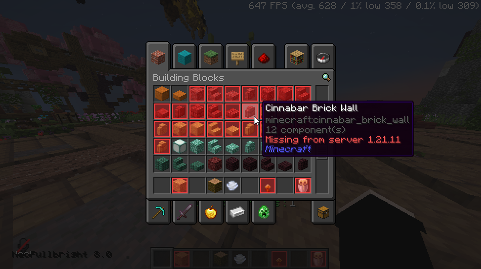

# CreativeVersion

A **client-side** Fabric mod that outlines in red the items that don't really exist on the server you're playing on. 
Example: a ViaVersion server (e.g. backend on 1.19.4, you on 26.2) — everything added after the backend version gets marked.

Marked slots appear **in creative tabs and in your inventory**, with a `Missing from server <version>` tooltip line. 
Purely visual: nothing is changed, nothing is sent to the server.

## Install

1. Install **Fabric Loader** (0.16+) and **Fabric API**.
2. Download the jar for your Minecraft version:
   | Minecraft | File |
   |---|---|
   | 1.21.10 | `creativeversion-1.21.10-1.0.0.jar` |
   | 1.21.11 | `creativeversion-1.21.11-1.0.0.jar` |
   | 26.1 → 26.3 | `creativeversion-26.x-1.0.0.jar` |
3. Drop it in `mods/` and launch the game.

## How it works

On join, it detects the backend version (ViaVersion channel when available, otherwise the ping version) and marks everything added after it.

If your server sits behind a proxy (Velocity, BungeeCord) that only advertises a version range (`1.8.x-1.21.x`), the real version can't be detected. 
Unless the proxy runs ViaVersion 5.3+, which reports it automatically. Otherwise nothing is marked.

## Limitations

- Marking is based on the **game version**, not server plugins: an item blocked by a plugin won't be marked.
- An experimental item present in the game but not yet obtainable counts as present.
- An item newer than the mod's data is treated as always available.